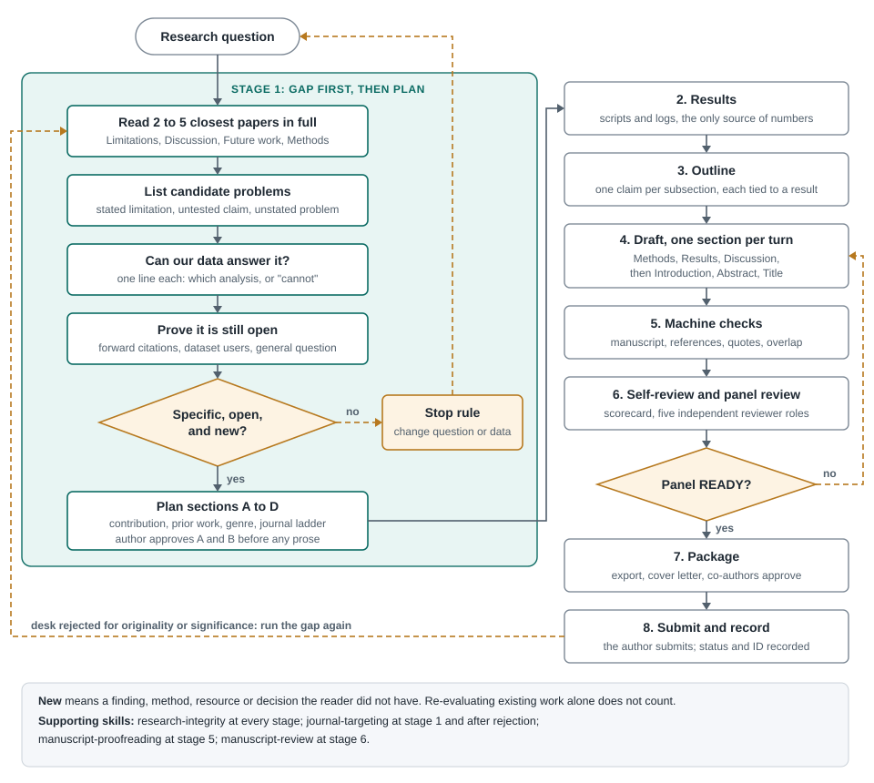

# academic-writing-skills

**English** · [Bahasa Indonesia](#bahasa-indonesia)

A Claude Code plugin for academic writing with an AI assistant: research integrity, bilingual
proofreading (English and Indonesian) with deterministic checkers, and a gated workflow for
journal articles. Built by a lecturer in Indonesia for his own teaching and research, and
generalised for anyone.

## Skills

| Skill | What it does |
|---|---|
| `research-integrity` | No number without a source, no citation from memory, claims sized to evidence. Authorship (ICMJE, CRediT), conflicts of interest, duplicate submission, Elsevier and Springer Nature AI-disclosure rules, REFORMS / TRIPOD+AI / PRISMA, and Indonesian regulation (Permendikbudristek 39/2021). |
| `manuscript-proofreading` | Fix errors without rewriting the author's voice. Runs two checkers, then reads in layers. Indonesian: EYD Edisi V, KBBI, italic foreign terms. English: numbers, tenses, terminology, claims. |
| `scientific-article-writing` | Research gap → plan → results files → Markdown manuscript → self-review → submission package → revision, with an approval gate at each stage. No plan until the gap is shown to be specific, still open, and new. |
| `journal-targeting` | Where to submit so the paper lands in an indexed journal: a ladder of three or four journals chosen before writing, fit tested against recent papers, index status verified on the official Scopus lists on the day of submission, hijacked and predatory journals ruled out, metrics read correctly (CiteScore percentile vs SJR quartile), and the path after rejection or a transfer offer. Maps Elsevier Researcher Academy modules to each stage. |
| `manuscript-review` | Simulated pre-submission peer review by five independent roles (editor, methods, domain, presentation, devil's advocate). Every finding quotes the manuscript; a script rejects quotes that are not there, merges findings raised by several roles, scores seven dimensions, applies fixed decision rules, and diffs a revision against the earlier review. |
| `thesis-audit` | Audits a skripsi, tesis, or disertasi (Indonesian or English, .docx or Markdown) as one research chain. A script runs mechanical checks (rumusan masalah ↔ tujuan ↔ kesimpulan, citations ↔ daftar pustaka with "dkk.", Tabel/Gambar N.M, abstract numbers); the model judges fourteen modules; a second script verifies quotes, enforces status and severity rules, and writes a supervisor report, a student feedback sheet, and defence questions. |

Skills activate automatically from their descriptions, in English or Indonesian. You can also
call them directly: `/academic-writing:research-integrity`.

## How the article workflow works



Stage 1 comes before any writing. The gap comes from the closest papers' own limitations and
untested claims, read in full, and a recorded search shows the problem is still open. The paper must
also add something new: a finding, method, resource, or decision the reader did not have.
Re-evaluating existing work alone does not count. If no candidate passes, change the question or
the data before going on. Procedure: `scientific-article-writing/references/gap-from-limitations.md`.

The prose comes after the results, so the Introduction and Abstract are written last, from what the
analysis actually showed. The panel in stage 6 can send a draft back. A desk rejection for
originality or significance sends the paper back to stage 1, not to a language edit.

### Review workflow (Python 3.10+, standard library only)

```bash
python prepare_review.py paper.md --out review/2026-10-01     # workspace, numbered lines, machine checks
# five reviewer agents write review/2026-10-01/findings/<role>.json
python consolidate_review.py review/2026-10-01                 # verify quotes, consensus, scorecard, report.md
python impact_review.py review/2026-10-01 review/2026-10-20    # after revision: stale values, sections edited
python diff_review.py review/2026-10-01 review/2026-10-20      # after revision: resolved / open / new
```

The reviewer roles ship as plugin agents (`review-editor`, `review-methods`, `review-domain`,
`review-presentation`, `review-devils-advocate`) so they can run in parallel and independently.
The flow was designed after studying the review pipelines in K-Dense scientific-agent-skills,
Imbad0202 academic-research-skills, and bahayonghang academic-writing-skills; the revision-impact
check and the not-assessable state follow ideas in ARKANAALZAIR thesis-debugger; the code and text
here are original.

### Thesis audit (Python 3.10+, standard library only)

```bash
python prepare_audit.py skripsi_budi.docx --level skripsi --out audit/budi/2026-10-01   # convert, machine checks, chain
# the model writes audit/budi/2026-10-01/audit.json (fourteen modules)
python report_audit.py audit/budi/2026-10-01                                         # verify, reconcile, report.md + feedback.md
```

`thesis-audit` also takes its framing from thesis-debugger; where that skill asks the model to
reconcile its own counts, here `report_audit.py` does it and refuses an audit that does not add up.

### Checkers (Python 3.10+, standard library only)

- `check_manuscript_en.py` — English Markdown manuscripts: abstract numbers missing from the
  body, citations without references and vice versa, tables/figures never cited, leftover
  placeholders, and machine-prose patterns.
- `check_grammar_lt.py` — optional LanguageTool grammar/spelling pass (Java 17+, `pip install language_tool_python`).
- `periksa_gaya.py` + `pola/claudish_id.json` — Indonesian prose: essay-style openers, empty
  throat-clearing, rhetorical questions, puffery, wrong register, repeated emphasis words.

```bash
python check_manuscript_en.py paper.md
python periksa_gaya.py bab_02.md
```

## Install

```
/plugin marketplace add agustinohalim/academic-writing-skills
/plugin install academic-writing@academic-writing-skills
```

Or from a shell: `claude plugin marketplace add agustinohalim/academic-writing-skills`, then
`claude plugin install academic-writing@academic-writing-skills`.

To enable it for everyone working in a project, add to the project's `.claude/settings.json`:

```json
{
  "extraKnownMarketplaces": {
    "academic-writing-skills": {
      "source": { "source": "github", "repo": "agustinohalim/academic-writing-skills" }
    }
  },
  "enabledPlugins": { "academic-writing@academic-writing-skills": true }
}
```

Update later with `/plugin marketplace update academic-writing-skills`.

## Caveats

- Publisher AI policies and Indonesian credit rules change. `references/sources.md` records when
  each was checked; verify against the source before you submit.
- The checkers narrow the reading, they do not replace it. A clean run means the known patterns
  are absent, not that the prose is good.

## License

Code in `plugins/**/scripts/`: MIT. Everything else: CC BY 4.0. See `LICENSE`.

Third-party: `scientific-article-writing/references/third-party/k-dense/` contains two checklists
from [K-Dense-AI/scientific-agent-skills](https://github.com/K-Dense-AI/scientific-agent-skills),
MIT, © 2025 K-Dense Inc. (licence included in that folder). Pattern ideas from
[blader/humanizer](https://github.com/blader/humanizer) (MIT).

---

## Bahasa Indonesia

Plugin Claude Code untuk menulis karya ilmiah bersama asisten AI: integritas riset, proofreading
dwibahasa (Indonesia dan Inggris) dengan pemeriksa otomatis, dan alur kerja artikel jurnal
bergerbang. Disusun seorang dosen di Indonesia untuk pengajaran dan risetnya sendiri, lalu
diumumkan supaya bisa dipakai siapa pun.

### Skill

| Skill | Isinya |
|---|---|
| `research-integrity` | Tidak ada angka tanpa asal, tidak ada sitasi dari ingatan, klaim sebesar buktinya. Kepengarangan (ICMJE, CRediT), konflik kepentingan, pengajuan jamak, kebijakan AI Elsevier dan Springer Nature, REFORMS / TRIPOD+AI / PRISMA, dan Permendikbudristek 39/2021. |
| `manuscript-proofreading` | Memperbaiki kesalahan tanpa mengganti suara penulis. Pemeriksa otomatis dulu, lalu pembacaan berlapis. Indonesia: EYD Edisi V, KBBI, istilah asing miring. Inggris: angka, *tenses*, istilah, klaim. |
| `scientific-article-writing` | Celah riset → rencana → berkas hasil → naskah Markdown → tinjauan mandiri → paket kirim → revisi, dengan gerbang persetujuan di tiap tahap. Rencana tidak ditulis sebelum celahnya terbukti spesifik, masih terbuka, dan baru. |
| `journal-targeting` | Memilih jurnal agar naskah terbit di jurnal terindeks: tangga tiga–empat jurnal yang dipilih sebelum menulis, kecocokan diuji pada naskah terbitan terbaru, status indeks diverifikasi di daftar resmi Scopus pada hari pengiriman, jurnal bajakan dan predator disingkirkan, metrik dibaca dengan benar (persentil CiteScore vs kuartil SJR), serta langkah setelah penolakan atau tawaran transfer. Memetakan modul Elsevier Researcher Academy ke tiap tahap. |
| `manuscript-review` | Simulasi telaah sebelum kirim oleh lima peran terpisah (editor, metode, bidang, penyajian, *devil's advocate*). Setiap temuan mengutip naskah; skrip menolak kutipan yang tidak ada, menggabungkan temuan yang diangkat beberapa peran, memberi skor tujuh dimensi, menerapkan aturan keputusan tetap, dan membandingkan revisi dengan telaah sebelumnya. |
| `thesis-audit` | Audit skripsi, tesis, atau disertasi (Indonesia atau Inggris, .docx atau Markdown) sebagai satu rantai riset. Skrip memeriksa hal mekanis (rumusan masalah ↔ tujuan ↔ kesimpulan, sitasi ↔ daftar pustaka termasuk "dkk.", Tabel/Gambar N.M, angka abstrak); model menilai empat belas modul; skrip kedua memverifikasi kutipan, menegakkan aturan status dan keparahan, lalu menulis laporan pembimbing, lembar umpan balik mahasiswa, dan pertanyaan sidang. |

Skill aktif otomatis dari deskripsinya, baik Anda menulis dalam bahasa Indonesia maupun Inggris,
dan menjawab dalam bahasa Anda. Bisa juga dipanggil langsung: `/academic-writing:manuscript-proofreading`.

### Cara kerja alur artikel


Tahap 1 mendahului semua penulisan. Celah diambil dari batasan dan klaim tak teruji makalah
terdekat, yang dibaca penuh, lalu pencarian yang tercatat menunjukkan masalahnya masih terbuka.
Naskah juga harus menambahkan sesuatu yang baru: temuan, metode, sumber daya, atau keputusan yang
belum dimiliki pembaca. Mengevaluasi ulang karya yang sudah ada saja tidak cukup. Bila tidak ada
calon yang lolos, ubah pertanyaan atau datanya sebelum lanjut. Prosedurnya ada di
`scientific-article-writing/references/gap-from-limitations.md`.

Prosa ditulis sesudah hasil, jadi Pendahuluan dan Abstrak ditulis terakhir, dari apa yang benar-benar
ditunjukkan analisis. Panel di tahap 6 dapat mengembalikan draf. Penolakan editor karena orisinalitas
atau signifikansi mengembalikan naskah ke tahap 1, bukan ke penyuntingan bahasa.

### Memasang

```
/plugin marketplace add agustinohalim/academic-writing-skills
/plugin install academic-writing@academic-writing-skills
```

Untuk mengaktifkannya bagi semua orang di satu proyek, tambahkan blok `extraKnownMarketplaces`
dan `enabledPlugins` seperti contoh di atas ke `.claude/settings.json` proyek itu.

### Catatan

- Kebijakan AI penerbit dan ketentuan angka kredit berubah. Periksa sumber resminya sebelum
  mengirim; tanggal pemeriksaan tercatat di `references/sources.md`.
- Pemeriksa mempersempit pembacaan, tidak menggantikannya.

### Lisensi

Kode di `plugins/**/scripts/`: MIT. Selebihnya: CC BY 4.0. Lihat `LICENSE`.
